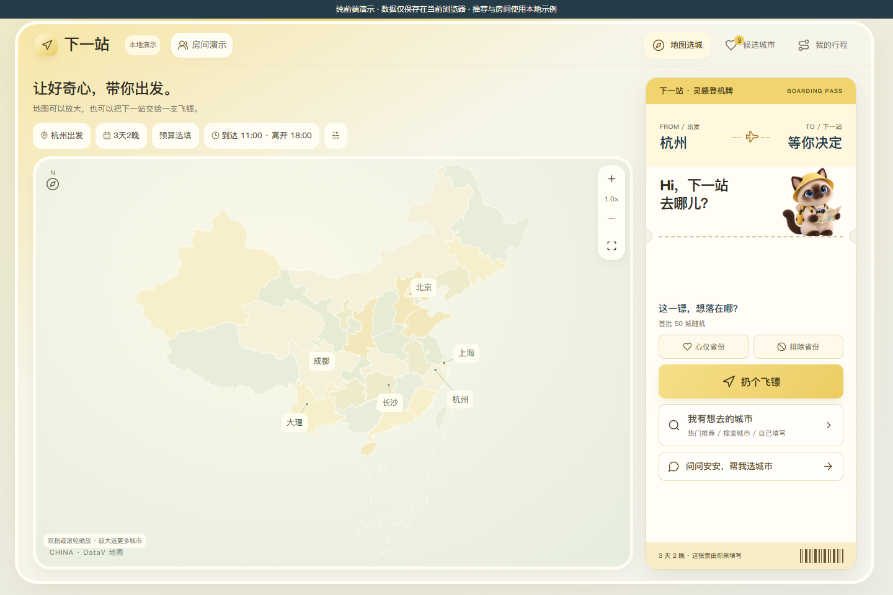
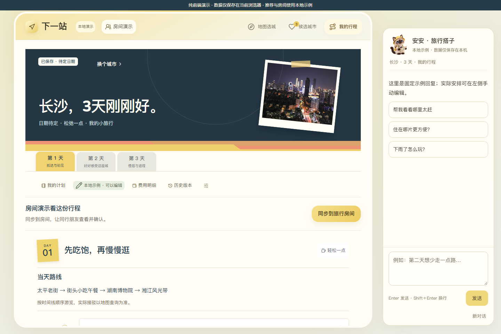
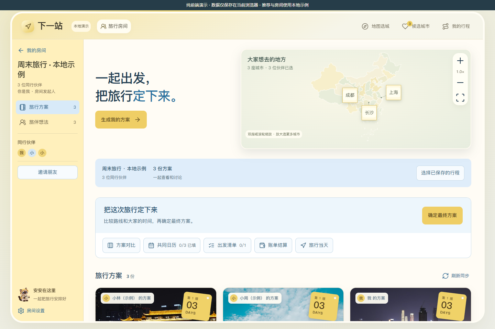

# 下一站 · 纯前端复刻源码

这是可以直接运行的完整前端，不是截图参考，也不需要重新写一个相似网站。请从现有代码继续修改，保留原来的中国地图、安安头像、城市照片和旅行票券布局。

**请使用 `frontend-redcowork` 分支。仓库 `main` 是历史完整版，不是本次纯前端交付。**

**不能下载 ZIP？** 先看 [免 ZIP 导入说明](IMPORT-WITHOUT-ZIP.md)。可通过 [FILES.json](FILES.json) 逐文件获取，也可以保存 [可编辑单文件 HTML](https://raw.githubusercontent.com/urnotccw/nextstop-travel/refs/heads/frontend-redcowork/editable-single-file.html)。单文件的图片、字体使用公开静态链接；需要全部本地保存时使用文件清单。

- [下载这份纯前端源码 ZIP](https://github.com/urnotccw/nextstop-travel/archive/refs/heads/frontend-redcowork.zip)
- [直接下载地址（codeload）](https://codeload.github.com/urnotccw/nextstop-travel/zip/refs/heads/frontend-redcowork)
- [给 REDcowork 的执行说明](START-HERE.md)
- [原始需求与技术说明](docs/REQUIREMENTS-AND-TECHNICAL.md)
- [素材来源](credits.html)

## 如何运行

解压后进入文件夹，直接打开根目录 `index.html`。也可以将整个文件夹作为静态资源导入作品平台。页面入口、脚本、样式和素材必须保持同层相对路径关系。

不需要安装依赖、构建、API Key、后端服务或数据库。平台自己的预览服务可以正常使用；作品本身没有服务器逻辑。

## 交给其他制作工具的话

> 请下载本仓库的 frontend-redcowork 分支，先阅读 START-HERE.md，再运行根目录 index.html。直接复用并修改这份已有前端，不要重新设计一套类似页面。保留 assets 中的真实地图数据、安安头像和城市照片，按 reference 的截图校对。不得添加后端、接口服务、数据库、鉴权或外部生成服务。如果你无法下载或读取源码，请明确说明，不要根据文字重新画一个近似版本。

## 界面基准

以下图片来自这份纯前端代码，代表本次要保留的界面。

## 功能边界

- 地图拖动缩放、飞镖选城、候选收藏、行程编辑、费用记录、本地保存可操作。
- 长沙、成都、上海、北京、杭州、大理有预置行程；其他城市或超出模板天数的安排需要手动补充。
- 安安回复为本地固定示例，不进行任意自然语言规划，也不查询实时票价、天气或酒店。
- 房间、伙伴、投票都是本机演示，不支持真实多人同步和跨设备加入。
- 数据只保存在当前浏览器。仓库不包含用户的个人记录、真实房间数据或凭证。
- 只做桌面版，保留页面上的本地演示说明。

## 源码导航

| 文件 | 用途 |
| --- | --- |
| `index.html` | 静态入口；保留现有脚本与样式加载顺序 |
| `app.js` | 地图、导航、个人行程和表单 |
| `frontend-demo.js` | 浏览器内的示例内容与 localStorage 读写 |
| `rooms.js`、`room-tools.js` | 本地房间、投票、清单等交互 |
| `trip-chat.js` | 安安侧栏与示例对话 |
| `boarding-pass.css` | 首页登机牌样式 |
| `assets/china-data.js` | 中国地图地理数据，不得换成手绘轮廓 |
| `assets/anan-*.png` | 原版安安形象，不得换成 emoji 或文字头像 |
| `assets/first50/` | 本地城市照片 |
| `reference/` | 视觉校对截图，不参与运行 |
| `docs/` | 需求、说明与既有验证记录 |

`docs/source-manifest.json` 记录运行文件的 SHA-256，可核对下载与导入是否完整。文档中的既有验证记录对应本地纯前端版；没有声称已经通过 REDcowork 的导入验证。
